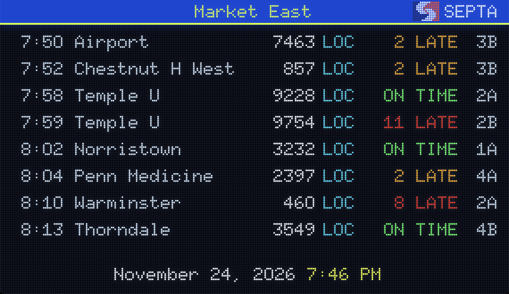

# On Track



An LED-style departure board for one SEPTA Regional Rail station, in the
style of the Jefferson Station platform signs. A small server fetches live
departures from SEPTA, and any browser on the network shows the board. An
old iPad in kiosk mode works well.

Departures come from SEPTA's public
[Arrivals API](https://www3.septa.org/api/Arrivals/index.php). No account or
API key is needed.

| Path          | What it is                     |
| ------------- | ------------------------------ |
| `/`           | The departure board            |
| `/departures` | The same data as JSON          |

## Getting Started

### Install

```sh
cd On-Track
uv sync
```

### Configure

```sh
cp config.example.toml config.toml
```

Set `station` to SEPTA's name for your station, such as
`"Jefferson Station"`, `"Suburban Station"` or `"Gray 30th Street"`. SEPTA's
[station list](https://www3.septa.org/VIRegionalRail.html) has the exact
spellings. A misspelled station shows "NO DEPARTURES LISTED".

| Setting           | Default               | Description                                         |
| ----------------- | --------------------- | --------------------------------------------------- |
| `station`         | `"Jefferson Station"` | SEPTA's name for the station.                       |
| `title`           | station name          | Header text. Defaults to the name without "Station".|
| `direction`       | `"both"`              | `both`, `northbound` or `southbound`.               |
| `rows`            | `8`                   | Departures on the board (1–12).                     |
| `refresh_seconds` | `30`                  | How often to ask SEPTA for new data (15 or more).   |
| `time_format`     | `"12"`                | `"12"` or `"24"` hour times.                        |
| `host`, `port`    | `0.0.0.0`, `8000`     | Address the server listens on.                      |
| `log_level`       | `"INFO"`              | Python logging level.                               |

Any setting can be overridden with an `OT_` environment variable, such as
`OT_STATION="Suburban Station"`. To read the configuration from another
file, set `ON_TRACK_CONFIG` to its path.

### Run

```sh
uv run python main.py
```

Open `http://localhost:8000/`, or `http://<this computer's address>:8000/`
from another device.

## Reading the Board

- **Status:** green ON TIME; amber for 1–4 minutes late; red for 5 or more
  minutes late, and for anything else SEPTA reports, such as SUSPENDED.
- **Track:** track and platform together, as on the station signs (`3B`). A
  track or platform change blinks in yellow.
- **Footer:** DELAYED DATA means SEPTA did not answer the last request, so
  the board is showing the last good data. OFFLINE means the display cannot
  reach this server.

However many displays are open, the server asks SEPTA at most once per
`refresh_seconds`.

## Using an iPad as the Display

1. Open the board in Safari, then Share → Add to Home Screen. Opened from
   the Home Screen, it runs full screen.
2. Turn on Guided Access (Settings → Accessibility) to lock the iPad to the
   board, and set Auto-Lock to Never.

The page uses older JavaScript and CSS so it runs on older iPads, and it
reloads itself every 6 hours.

The board works either way up. On a wide screen each departure takes one
line. On a tall one, such as a phone or an upright iPad, it takes two: time,
destination and track, then train, service and status. The board picks
whichever layout gives the bigger text, and switches when the screen
rotates.

## Development

```sh
uv run pytest
uv run ruff check .
```

The tests use a saved SEPTA response in `tests/fixtures/`.

`scripts/redraw_glyphs.py` redraws a few characters in the board's font
file. The new shapes are drawn as dot grids at the top of the script; edit
them and run:

```sh
uv run scripts/redraw_glyphs.py
```

`scripts/logo_dots.py` turns the SEPTA logo (`scripts/septa-logo.svg`) into
the LED dots in the title bar, and writes them into `templates/board.html`.
Rerun it after changing the logo's size or colors, which are set at the top
of the script:

```sh
uv run scripts/logo_dots.py
```

## Credits

The board uses the [Doto](https://github.com/oliverlalan/Doto) font, under
the SIL Open Font License (`static/fonts/OFL.txt`). The copy in
`static/fonts/` is modified: `0` is redrawn as an oval in place of Doto's
diamond, and `:` `;` `.` `,` use single dots (see
`scripts/redraw_glyphs.py`).

The SEPTA logo in the title bar is drawn from
[SEPTA.svg](https://commons.wikimedia.org/wiki/File:SEPTA.svg) on Wikimedia
Commons. SEPTA's name and logo are SEPTA's trademarks; this project is not
affiliated with SEPTA.
